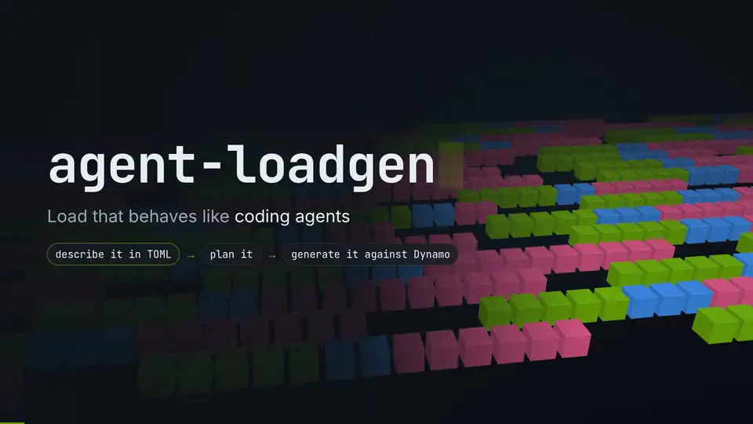

# agent-loadgen

[](docs/assets/agent-loadgen-intro.mp4)

Click the animation for the full-resolution video with playback controls.

`agent-loadgen` is a Rust load generator for coding-agent traffic through a Dynamo OpenAI-compatible frontend.

`generate` creates deterministic coding-agent traffic with tools, compaction, subagents, and swarms from a strict TOML profile, either as a fixed pool of agent workers or as sessions arriving on an hours-long rate schedule.

To turn a description of a customer's traffic into a run, start with [Describe a workload](docs/workloads.md). Coding agents can follow the [agent-loadgen skill](.agents/skills/agent-loadgen/SKILL.md), which agents that read `.agents/skills/`, such as Codex, load automatically in this repository.

Prompt text is synthetic. The fidelity contract is request shape, KV reuse, agent lineage, and timing.

Traffic shape and wire protocol are separate. The profile defines shape. The required `--headers {claude-code|codex}` flag on `generate` selects which harness the requests look like: each dialect sends only that harness's own session, subagent, and compaction headers, and Dynamo derives session identity from them. See [Harness headers](docs/headers.md).

## Build

```bash
cargo build --release
```

## Generate agent traffic

Pick a shape from `profiles/`: `claude-code.toml`, `codex.toml`, `swe-bench.toml`, or `diurnal-8h.toml` (the Claude Code shape under an eight-hour request-rate schedule). Summarize it without sending traffic:

```bash
target/release/agent-loadgen plan \
  --config profiles/diurnal-8h.toml \
  --output artifacts/diurnal-plan
```

`plan-summary.json` reports session and request statistics, the ideal prefix-cache hit rate, expected totals, and the expected request rate in each schedule bucket. Run it against a deployment, here as Claude Code, and stop after two hours:

```bash
target/release/agent-loadgen generate \
  --config profiles/diurnal-8h.toml \
  --headers claude-code \
  --model zai-org/GLM-4.7-Flash \
  --target http://127.0.0.1:8000 \
  --tokenizer /models/GLM-4.7-Flash \
  --output artifacts/diurnal-run \
  --stop-after-minutes 120
```

Generated traffic is closed-loop inside each session: model latency, tool time, compaction, and blocking subagent joins determine when the next request becomes ready. Sessions start at scheduled arrival times, or one after another in a fixed number of streams. Every subagent is a separate child session with explicit parent lineage. Each session tree is planned when it starts, so a run of any length holds only live sessions in memory.

## Serve the dashboard API

Run the HTTP service that turns TOML profiles into plan previews for the traces dashboard, in process:

```bash
target/release/agent-loadgen serve --listen 127.0.0.1:8096
```

It never sends load itself. See [HTTP service](docs/serve.md).

## Outputs

- `plan-summary.json`: sampled session and request statistics, expected totals, and per-bucket arrivals for a generated plan of any size.
- `requests.jsonl`: one result per completed request, including timing and output fidelity.
- `timeline.csv`: requests, failures, root sessions started, request and token rates, and TTFT and latency percentiles per time bucket.
- `run.json`: run configuration including the header dialect and HTTP version, achieved throughput and latency percentiles, and pass/fail status: a run passes when every sent request succeeded with its planned output length.

## Documentation

- [Describe a workload](docs/workloads.md): from a traffic description to a profile, a plan summary, a run, and its results.
- [How it works](docs/how-it-works.md): timing models, dependency scheduling, subagents, request construction, and module boundaries.
- [Harness headers](docs/headers.md): Claude Code and Codex session, subagent, compaction, and gateway hint headers.
- [Generator configuration](docs/generator.md): profiles, load models, distributions, tools, limits, and every default.
- [Subagents and swarms](docs/subagents.md): delegation graphs, joins, lineage, KV sharing, and current limits.
- [Compaction](docs/compaction.md): trigger logic, physical attempts, KV-window changes, and telemetry boundaries.
- [HTTP service](docs/serve.md): `agent-loadgen serve` endpoints, metrics, and deployment behind Caddy.

## Current boundaries

- Chat Completions is the only supported protocol surface.
- The tool does not generate meaningful prompt text or execute tools.
- Cache policy and routing behavior remain owned by Dynamo and the inference engine.
- Synthetic token IDs go through `nvext.token_data`, so the frontend must pass them to the engine unchanged, as Dynamo's Rust chat processor does.

## License

Apache-2.0. Files derived from NVIDIA Dynamo retain their NVIDIA copyright headers. See `NOTICE`.
